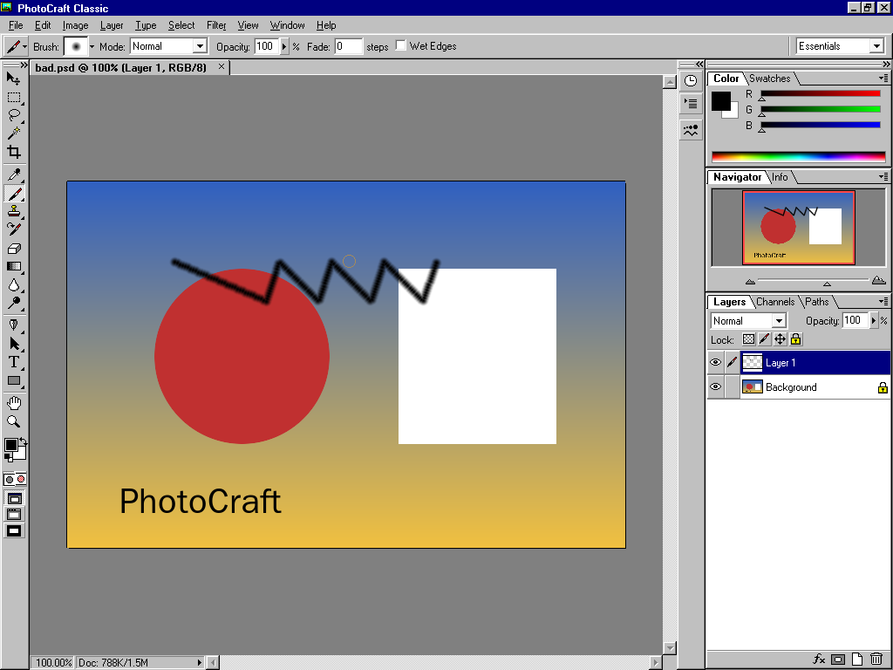
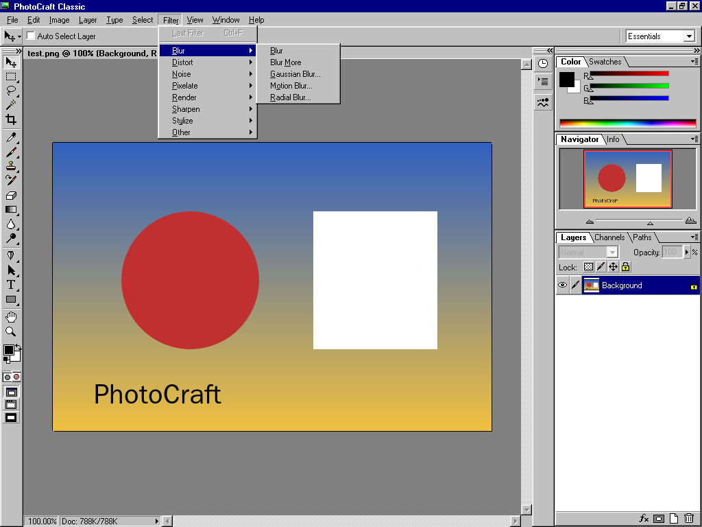
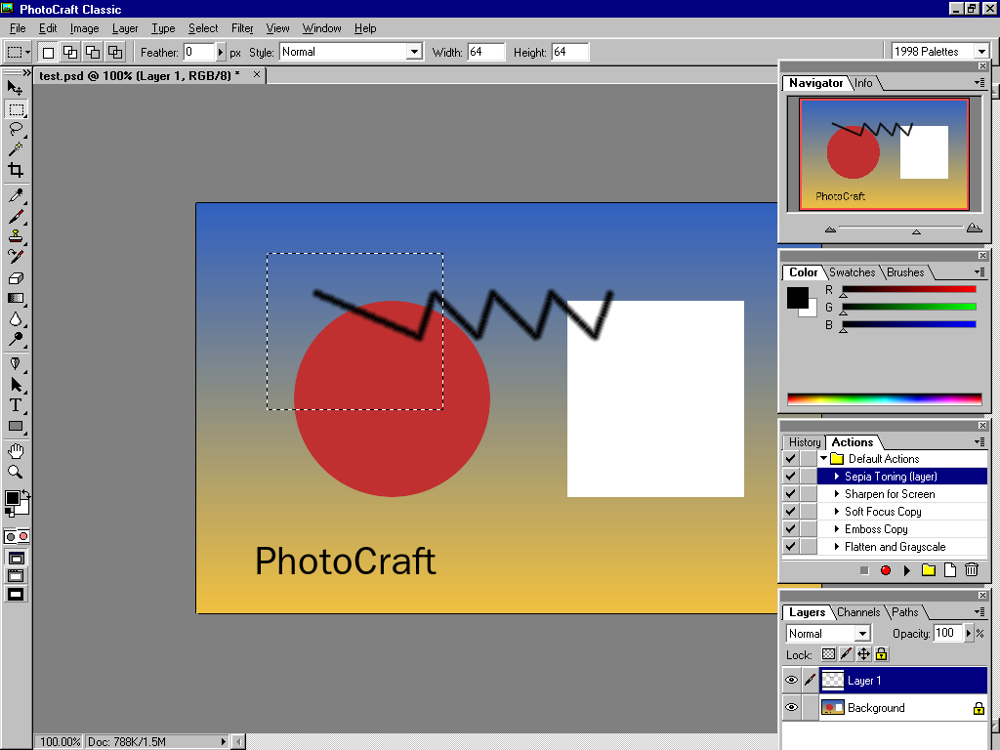
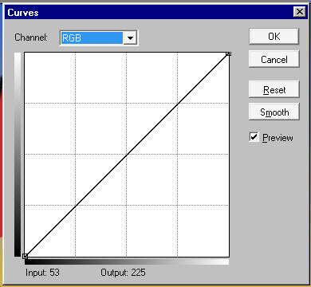
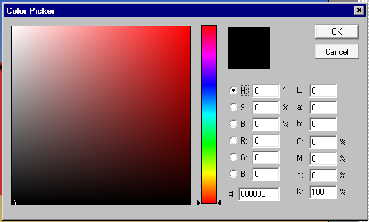
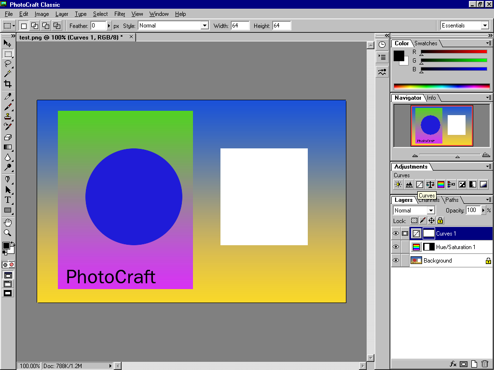
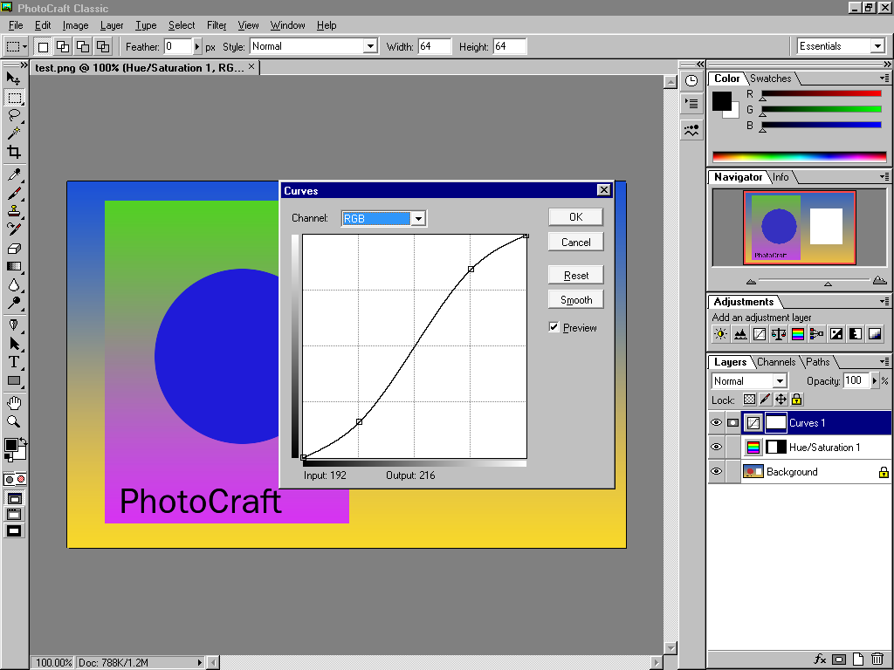

# PhotoCraft Classic

A working image editor that looks and feels like a professional graphics program
on a Windows 98 desktop in 1998. The workspace is arranged like Photoshop CS6
(Options bar, Tools panel, panel dock, tabbed documents), and every pixel of it is
drawn in the Windows 95 style: gray 3D bevels, navy title bars, MS Sans Serif,
and original 16-color pixel-art icons. A "1998 Palettes" workspace switches to
Photoshop 5.0-style floating palettes.

It is one small 32-bit program (about 700 KB) with no C runtime DLL. It uses only
the Windows 95 API, so it targets Windows 95, 98, ME, NT 4.0, 2000, XP, Vista,
7, 8, 8.1 and 10 alike.



| | |
|---|---|
|  |  |
|  |  |
|  |  |

> PhotoCraft Classic is an independent open-source project. It is not affiliated
> with or endorsed by Adobe. Photoshop is mentioned only to describe the style the
> interface recreates. All artwork is original.

## Features

- **Tools:** Move, Marquees (rectangle, ellipse, row, column), Lasso,
  Polygonal Lasso, Magnetic Lasso, Magic Wand, Crop, Eyedropper, Measure,
  Paintbrush, Airbrush, Pencil, Rubber Stamp, Pattern Stamp, History Brush,
  Eraser, Gradient, Paint Bucket, Blur, Sharpen, Smudge, Dodge, Burn, Sponge, Pen,
  Freeform Pen, Magnetic Pen, the anchor point tools, Path and Direct Selection,
  Type (horizontal, vertical, and both mask variants), Rectangle, Ellipse, Line,
  Hand and Zoom. Each has flyouts, a shortcut letter and Shift+letter cycling.
- **Layers:** 17 blend modes, opacity, layer masks, clipping groups and locks.
  Type layers stay editable. Layer effects: drop shadow, inner shadow, outer
  glow, bevel.
- **Adjustment layers:** Brightness/Contrast, Levels, Curves, Color Balance,
  Hue/Saturation, Channel Mixer, Invert, Threshold and Posterize (the types
  Photoshop 5.0 had), from Layer > New Adjustment Layer or the Adjustments
  panel. Each has a layer mask you paint on, opacity, blend mode and
  clipping; double-click the thumbnail to change the settings. They are
  saved in PSD files the way Photoshop saves them.
- **Panels:**
  - Navigator, Info, Color, Swatches, Brushes and Adjustments.
  - Layers, Channels (including alpha channels and Quick Mask) and Paths.
  - History, with snapshots and the History Brush.
  - Actions, which record commands with their dialog settings and replay them.
- **Adjustments:** Levels, Curves, Color Balance, Brightness/Contrast,
  Hue/Saturation, Channel Mixer, Invert, Equalize, Threshold, Posterize,
  Desaturate and Auto Levels. All have live previews.
- **Filters:** 31 filters in the Blur, Sharpen, Noise, Stylize, Pixelate,
  Distort, Render and Other families.
- **Image and transform:** Image Size, Canvas Size, Rotate Canvas, Crop, Trim,
  Free Transform (scale, rotate, skew, distort) and Numeric Transform.
- **Files:** layered Photoshop PSD, BMP, GIF, JPEG, PNG, TIFF and Targa.
- **Workspace:**
  - Panels dock in the CS6 arrangement; tabs drag between groups, groups
    tear off into floating palettes, and groups collapse or hide.
  - Window > Workspace saves, loads and resets the layout.
  - Documents open as tabs or float in their own windows (Cascade, Tile).
  - Three screen modes; Tab and Shift+Tab hide the panels.
- **Updater:** Help > Check for Updates.
  - It downloads over HTTPS with its own TLS stack, so it doesn't depend on
    1998-era Windows TLS.
  - It checks an Ed25519-signed manifest and the SHA-256 of the installer, and
    refuses downgrades.
  - It installs through Windows Installer and keeps your settings.
- **Distribution:** a Windows Installer package targeting Windows Installer 1.1,
  plus a Setup.exe that installs the Windows Installer runtime on Windows 95/98
  and NT 4.0 when it is missing.

## Status and compatibility

This is the first preview (0.1.0). The executables pass an import audit against
a curated list of Windows 95 functions, contain no SSE/MMX code, and declare
subsystem 4.0. They have been smoke-tested under Wine with Wine set to report
Windows 95, 98 and 10. **They have not yet been run on real Windows machines.**
[docs/compatibility.md](docs/compatibility.md) keeps the matrix and the procedure
for VM testing.

## Building

Everything cross-compiles on Linux (Ubuntu 24.04 is what CI uses):

```bash
sudo apt-get install gcc-mingw-w64-i686 wixl msitools python3
```

```bash
make test      # engine, file format and updater tests (native, ASan/UBSan)
```

```bash
make check     # Windows binaries + Windows 95 import audit
```

```bash
make dist      # MSI, Setup.exe, standalone exe, checksums, update manifest in dist/
```

The Windows build links no C runtime: `src/rt` provides the few libc functions
the code needs on top of KERNEL32 (retail Windows 95 has no msvcrt.dll).

## Layout

| Path | What |
|---|---|
| `src/rt` | C runtime replacement for Windows (heap, strings, formatting, x87 math) |
| `src/core` | Portable editing engine: document model, copy-on-write history, compositor, adjustments, filters, transforms, selections, brush engine |
| `src/io` | File formats |
| `src/ui` | The Win32 interface |
| `src/updater`, `src/setup` | PCUpdate.exe and Setup.exe |
| `installer` | MSI authoring and release assembly |
| `docs` | [Historical UI reference](docs/historical-ui-reference.md), [design decisions](docs/design-decisions.md), [audit of PhotoCraft](docs/photocraft-audit.md), [updater](docs/updater.md), [releasing](docs/release.md) |

## License and credits

MIT OR Apache-2.0, like the project it grew from:
[PhotoCraft](https://github.com/storytold/photocraft) by the ArtCraft Team and the
PhotoCraft contributors. Parts of its image processing (blend modes, Color
Balance, the history model, the PSD structure) were ported to C from there. The
release also bundles [stb](https://github.com/nothings/stb), [BearSSL](https://bearssl.org/)
and [Monocypher](https://monocypher.org/). See [NOTICE](NOTICE) and
[ATTRIBUTION.md](ATTRIBUTION.md).
