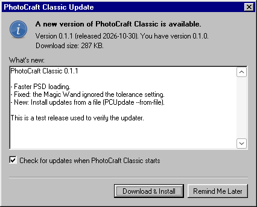
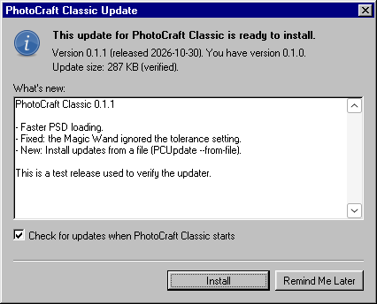

# Updater (PCUpdate.exe)

PhotoCraft Classic updates itself with `PCUpdate.exe`, a small separate program
installed next to `PhotoCraftClassic.exe`. It runs on Windows 95 through
Windows 10 with no C runtime, no WinINet/WinHTTP, no Schannel and no
comctl32. It ships its own TLS 1.2 client (BearSSL) and its own root
certificates. Updates are Windows Installer packages (MSI) described by a
small text manifest signed with Ed25519.



## Contents

- [Command line](#command-line)
- [Architecture](#architecture)
- [Flow](#flow)
- [Manifest format](#manifest-format)
- [Threat model](#threat-model)
- [Offline updates: "Install from File"](#offline-updates-install-from-file)
- [Rollback, recovery and settings](#rollback-recovery-and-settings)
- [Registry](#registry)
- [Contract with PhotoCraftClassic.exe](#contract-with-photocraftclassicexe)
- [Source layout and tests](#source-layout-and-tests)
- [Known limitations](#known-limitations)

## Command line

| Command | Use |
|---|---|
| `PCUpdate.exe` or `PCUpdate.exe --check [--pid N]` | Interactive check (Help > Check for Updates, Start menu shortcut). Always shows a result. |
| `PCUpdate.exe --auto [--pid N] [--force]` | Background check when the app starts. At most once per 24 hours (`--force` ignores that), only if `CheckOnStartup` is 1, silent unless an update is available, never shows network errors. |
| `PCUpdate.exe --from-file [manifest [msi]]` | Install an update downloaded on another computer. Verified exactly like an online update. Without arguments it asks for the files. |
| `PCUpdate.exe --apply <msi> <pid> [<sha256> [<appdir>]]` | Internal. Started by the updater itself from a temporary copy. |

`--pid` is the process ID of the running `PhotoCraftClassic.exe`. It is
optional: `--apply` also finds the app by its window class.

Exit codes: 0 means success or "nothing to do", 1 means an error or cancel.
`--apply` returns the Windows Installer exit code.

## Architecture

```
PhotoCraftClassic.exe --(starts)--> PCUpdate.exe --check/--auto
                                      |
                                      |  HTTPS GET (BearSSL TLS 1.2 over Winsock 1.1,
                                      |  optional HTTP CONNECT proxy from IE settings)
                                      v
                     github.com/.../releases/latest/download/update-manifest.txt
                                      |  302 -> release-assets.githubusercontent.com
                                      v
                     verify Ed25519 signature (pinned key) -> parse -> policy
                                      |
                       "Update available" dialog (version, notes)
                                      |
                     HTTPS GET msi_url -> %TEMP%\PhotoCraftClassic-Update\*.msi
                     check size + SHA-256 from the signed manifest
                                      |
                     copy PCUpdate.exe -> %TEMP%\...\PCUpdate-apply.exe
                     start it with --apply, exit
                                      v
PCUpdate-apply.exe --apply: re-hash the MSI, ask the app to close (it offers to save),
                            wait for it to exit, msiexec /i <msi> /qb REBOOT=ReallySuppress,
                            interpret the exit code, restart the app
```

Modules, all in `src/updater/`:

| File | Role |
|---|---|
| `updater.c` | `WinMain`, modes, dialogs, registry, `--apply` |
| `manifest.c/.h` | Manifest splitting, signature check, strict parser, versions, policy. Portable C. |
| `net.c/.h` | HTTPS GET over Winsock 1.1 + BearSSL, redirects, proxy, timeouts, progress, cancel, size caps, entropy |
| `httpparse.c/.h` | URL parsing, redirect resolution, HTTP response head parser, IE proxy-string parser. Portable C. |
| `trust_anchors.c/.h` | Bundled root CAs (generated, see [Trust anchors](#trust-anchors)) |
| `pubkey.h` | Pinned Ed25519 public key(s) |
| `chrome.c/.h` | Windows 95 window frame, caption, buttons, check boxes, progress bar, message box. `src/setup/` reuses it. |

The UI is a set of small windows created with `CreateWindowExA`, not dialog
templates. Top-level windows are `WS_POPUP` with a self-drawn frame: 3 px
raised border, 18 px navy caption (gray when inactive), bold MS Sans Serif
title and a 16x14 close button. On Windows Vista to 10 this avoids the DWM
title bar, so the windows look the same as on Windows 95. Push buttons and
check boxes are owner-drawn with the Windows 95 bevel colours. The progress
bar draws navy blocks in a sunken field. The exe has no visual-styles
manifest. On XP and later it calls `SetThemeAppProperties(0)`, found through
`GetProcAddress`.

### Windows 95 compatibility rules followed

- Only ANSI APIs that exist in Windows 95 retail are imported. `make check`
  enforces this with `tools/check_imports.py` and
  `tools/win95-api-allowlist.txt`.
- Newer functions are looked up at run time and skipped if missing:
  `CryptAcquireContextA`/`CryptGenRandom` (not on retail 95),
  `SystemFunction036` (RtlGenRandom, XP+), `GetOpenFileNameA` (comdlg32) and
  `SetThemeAppProperties` (uxtheme, XP+).
- **wsock32.dll is loaded with `LoadLibrary` too.** So PCUpdate.exe still
  starts on a Windows 95 PC without TCP/IP or Dial-Up Networking, and
  `--from-file` works there.
- BearSSL is built without SSE2, AES-NI, PCLMUL, RDRAND or POWER8 code, even
  behind CPUID checks, because Windows 95 does not save XMM registers on
  context switches. It is built with no OS random source and no OS clock.
  `objdump -d PCUpdate.exe | grep -c xmm` is 0. The settings are at the end
  of `third_party/bearssl/src/config.h`.
- No C runtime. `src/rt/pcrt.c` provides the few libc functions used.

## Flow

1. **Configuration.** The updater reads `HKCU\Software\PhotoCraft Classic\Update`
   (see [Registry](#registry)). The installed version is the higher of the
   compiled-in `PC_VERSION` and `HKLM\Software\PhotoCraft Classic\Version`.
2. **Fetch the manifest.** The URL is `ManifestURL`, by default
   `https://github.com/knivesbatz/PhotoCraftr/releases/latest/download/update-manifest.txt`.
   The download is capped at 16 KB and allows at most 5 redirects, all of
   them `https://`.
3. **Verify** the signature, parse the manifest and apply the policy:
   - `version` must be greater than the installed version;
   - `sequence` must be at least `LastSequence`;
   - `channel` must equal `Channel` (default `stable`).

   `LastSequence` is raised to the manifest's sequence after every verified
   manifest on our channel, including "up to date" results.
4. **Ask.** The dialog shows the version, the release date, the download size
   and the release notes. It has *Download & Install*, *Remind Me Later* and
   (in `--auto` only) *Skip This Version*, which stores `SkipVersion`. The
   check box sets `CheckOnStartup`.
5. **Download** `msi_url` to
   `%TEMP%\PhotoCraftClassic-Update\PhotoCraftClassic-<ver>-Setup.msi.part`.
   The download is limited to `msi_size` bytes, a Content-Length that differs
   from `msi_size` is refused, and SHA-256 is computed while downloading. The
   file is renamed to `.msi` only when the transfer is complete. If the size
   or hash does not match, it is deleted and nothing changes.
6. **Hand off.** PCUpdate.exe copies itself to `%TEMP%\...\PCUpdate-apply.exe`
   and starts it with `--apply "<msi>" <pid> <sha256> "<appdir>"`. Running
   from a copy lets Windows Installer replace the installed PCUpdate.exe.
7. **`--apply`**:
   - Re-hash the MSI. It sat in a user-writable folder.
   - Find the window class `PhotoCraftClassicFrame` and post it the
     registered message `PhotoCraftClassic.UpdateClose`. The app offers to
     save and exits. The updater waits for the process
     (`OpenProcess(SYNCHRONIZE)` + wait, or by polling the window), up to
     60 s per round. After that it shows "PhotoCraft Classic is still
     running... Retry / Cancel".
   - Run `msiexec /i "<msi>" /qb REBOOT=ReallySuppress INSTALLDIR="<current>"
     DESKTOPSHORTCUT=<current>` and wait for it.
   - Act on the exit code:

     | Code | Meaning | Action |
     |---|---|---|
     | 0, 1641 | success | restart the app |
     | 3010 | success, restart required | message, restart the app |
     | 1602 | the user cancelled | message, restart the old app |
     | 1618 | another installation is running | message, restart the old app |
     | anything else | failed and rolled back | message, restart the old app (see [Rollback](#rollback-recovery-and-settings)) |

   - Delete the downloaded MSI. Files the user selected with `--from-file`
     are never deleted.
8. Every step is logged to `%TEMP%\PhotoCraftClassic-Update\update.log`. The
   log is capped at 256 KB.

## Manifest format

The manifest is a text file named `update-manifest.txt`, published as a
release asset. Example:

```
PCUPDATE 1
product PhotoCraftClassic
channel stable
version 0.2.0
sequence 1793318400
released 2026-11-01
msi_url https://github.com/knivesbatz/PhotoCraftr/releases/download/v0.2.0/PhotoCraftClassic-Setup.msi
msi_size 1127936
msi_sha256 65987311d8b509250165872d8367a07661f30e4467164970034faba9bcbdaac4
notes PhotoCraft Classic 0.2.0
notes
notes - Faster PSD loading.
sig iunmC2fQDqMwLJZ2vvhQeK5SzoVwG/48ogo7s6pj8BdX1EQKejcz/HYVtCm6Wt0x2aSolK8OJDuYaDigILM7BA==
```

### File and line rules

- The file is at most 16384 bytes, signature included.
- Lines end with LF or CRLF.
- A line is at most 1024 bytes, without its terminator.
- Allowed bytes are printable ASCII 0x20 to 0x7E. Bytes 0x80 to 0xFF are
  allowed only in `notes` values and are shown as Windows-1252. Any other
  control character, including TAB, a stray CR or NUL, is an error.
- The first line is exactly `PCUPDATE 1`, the format version.
- Every other line is `key SP value`:
  - `key` is 1 to 31 characters from `[a-z0-9_]`;
  - exactly one space separates key and value;
  - values may not have leading or trailing spaces;
  - blank lines are not allowed.
- **Signature line.** The signature is on the first line that starts with
  `sig `. It must be the last line: only one optional CR/LF may follow it.
  Its value is the standard base64 (RFC 4648, padded, canonical) of a 64-byte
  Ed25519 signature, so exactly 88 characters.
- **Signed bytes** are every byte of the file before the `sig ` line,
  including the final line terminator before it. Nothing is normalised.
- Unknown keys are allowed and ignored. They are covered by the signature,
  so newer releases can add fields that older updaters skip.

### Fields

Each field appears at most once, except `notes`.

| Key | Required | Value |
|---|---|---|
| `product` | yes | `PhotoCraftClassic`. Any other value is rejected, even with a valid signature. |
| `channel` | yes | `[a-z0-9-]{1,31}`. Must equal the updater's `Channel` (default `stable`). |
| `version` | yes | Semantic version `MAJOR.MINOR.PATCH[-PRERELEASE]`. No build metadata, no leading zeros. MAJOR and MINOR are 0 to 255 and PATCH is 0 to 65535, the MSI ProductVersion limits. Compared by SemVer 2.0 precedence. |
| `sequence` | yes | Decimal 0 to 4294967295, no leading zeros. Must never decrease between releases. `tools/make-manifest.sh` uses the build time (Unix seconds). |
| `released` | yes | `YYYY-MM-DD`, a valid calendar date. Display only. |
| `msi_url` | yes | `https://` URL, at most 511 bytes, no spaces, quotes, backslashes or user-info. |
| `msi_size` | yes | Decimal byte count, 1 to 536870912 (512 MB). |
| `msi_sha256` | yes | 64 hex digits (any case). |
| `notes` | no | One line of release notes per `notes` line, joined with CRLF. A bare `notes` is an empty line. At most 64 lines and 4095 bytes in total. |
| `sig` | yes | See above. |

### Processing order

`pc_manifest_load()` processes a manifest in this order:

1. Check the size.
2. Find the `sig ` line and decode the base64.
3. **Check the Ed25519 signature over the raw bytes against every pinned
   key.**
4. Only then parse the signed body with the strict parser.
5. Check `product`.

Unauthenticated bytes therefore only reach the line splitter and base64
decoder, which are both bounded. The parser is fuzzed in `make test` anyway.

### Making and signing a manifest

```
tools/make-manifest.sh dist/PhotoCraftClassic-Setup.msi 0.2.0 docs/release-notes.md > m.txt
build/native/pcsign sign <secret-key-file or -> m.txt > update-manifest.txt
build/native/pcsign verify <public-key-hex> update-manifest.txt
```

`make dist` does both steps (see [docs/release.md](release.md)).

## Threat model

**What we protect:** users must never install code that the PhotoCraft
Classic release key did not approve, and must never be moved to an older
approved version.

| Layer | Protects against | Notes |
|---|---|---|
| **HTTPS with bundled BearSSL and pinned roots** | Passive eavesdropping, simple tampering, and redirects to attacker hosts on old systems whose own TLS stack (Schannel/WinINet on 95/98) cannot talk to GitHub at all | TLS 1.2 only. Uses the 10 roots in `tools/trust/` and never the OS store. Only `https://` is ever fetched; an `http://` redirect is refused, and there is no insecure fallback. Certificate time comes from the PC clock. |
| **Ed25519-signed manifest, pinned key** (`src/updater/pubkey.h`) | A compromised GitHub account, release asset, CDN, CA or TLS interception: none of them can produce a manifest without the private key | Monocypher `crypto_ed25519_check`. Several keys can be pinned for rotation. |
| **SHA-256 and size of the MSI in the signed manifest** | A swapped or corrupted installer | Checked after download and again by `--apply`, because the temp folder is user-writable. |
| **Version and sequence policy** | Downgrade and replay: serving an older, validly signed manifest to bring back an old vulnerable version | `version` must be greater than the installed version and `sequence` must be at least the stored `LastSequence`. The MSI itself also blocks downgrades (`MajorUpgrade`). |
| **Windows Installer transaction** | A half-installed update | See [Rollback](#rollback-recovery-and-settings). |

### Not protected (accepted)

- **A compromised signing key.** Rotate the key: ship a release that pins
  old + new, then sign with the new one (docs/release.md). A stolen key
  cannot be revoked remotely; the offline key handling in docs/release.md is
  the mitigation.
- **Freeze attacks.** An attacker who controls the network can keep serving
  the latest manifest this PC has already seen, or block updates entirely.
  The user sees "up to date" or a network error. `released` is shown so a
  stale date is visible. There is no expiry field yet (format version 1);
  one could be added as an unknown-key-tolerant field later.
- **Malware already running as the user.** It can replace PCUpdate.exe
  itself. The updater does not defend against local attackers with the same
  privileges.
- **Weak entropy on Windows 95.** The TLS client random and ECDHE keys need
  randomness. Retail Windows 95 has no CSPRNG API. The updater hashes
  together, with SHA-256:
  - GetTickCount, QueryPerformanceCounter/Frequency (the 1.19 MHz PIT on 95);
  - cursor position, GlobalMemoryStatus, process and thread IDs, system time,
    foreground window, stack and heap addresses;
  - 64 rounds of busy-loop and `Sleep(0)` timing jitter;
  - the timing of DNS and connect;
  - CryptGenRandom or RtlGenRandom when present;
  - a 32-byte seed saved in the registry (`RandomSeed`) by the previous run.

  The result goes into `br_ssl_engine_inject_entropy`. This is adequate for
  TLS confidentiality of a public download, and the security of the update
  does not depend on it: authenticity comes from the Ed25519 signature,
  which needs no client randomness.

### No TCP/IP, or a wrong clock

- **No TCP/IP or Winsock** (a Windows 95 installation without networking):
  `wsock32.dll` is loaded at run time, so the updater still starts. The
  check reports "TCP/IP networking (Windows Sockets) is not installed" and
  offers **Install from File...**.
- **Wrong clock:** certificate validation fails with "The security
  certificate of github.com is not valid at the current date. Please check
  that your computer's date and time are set correctly." This is a
  documented limitation; correct the clock or use Install from File. There
  is deliberately no "ignore" button.
- **Corporate proxy:** the manual proxy from Internet Explorer's settings is
  used (`ProxyEnable`/`ProxyServer`/`ProxyOverride` in
  `HKCU\Software\Microsoft\Windows\CurrentVersion\Internet Settings`). Both
  the `host:port` and the `http=...;https=...` forms are understood. Proxy
  auto-configuration (PAC/WPAD) and proxy authentication are **not**
  supported. A TLS-intercepting proxy is refused by design: the update is
  then only possible with Install from File. The `Proxy` value in our own
  key overrides IE: `direct`, or `host:port`.

## Offline updates: "Install from File"

`PCUpdate.exe --from-file`. It is also offered as a button whenever an
online check fails.

1. The user downloads `update-manifest.txt` and `PhotoCraftClassic-Setup.msi`
   from the releases page on any computer and copies both, for example on a
   floppy, CD or network share.
2. PCUpdate.exe asks for the manifest. It uses `GetOpenFileNameA` from
   comdlg32, loaded at run time, and falls back to a "type the path" window.
3. It applies the same signature check, the same version/sequence/channel
   policy, and updates `LastSequence`.
4. It looks for the MSI next to the manifest under the file name of
   `msi_url`. If it is not there, it asks for it. Then it checks the size and
   SHA-256.
5. It shows the "ready to install" dialog, then runs the same `--apply` path.
   The user's files are not deleted afterwards.



## Rollback, recovery and settings

- **Transactional upgrade.** The MSI is a major upgrade with
  `RemoveExistingProducts` sequenced right **after `InstallInitialize`**
  (`build-msi.sh` moves it and verifies the position). Removing the old
  version is part of the same installation script. If any later step fails
  or the user cancels, Windows Installer rolls back everything and the
  previous version stays installed. The updater then says so and restarts
  the old app.
- **Defence in depth.** After a failure the updater checks that
  `PhotoCraftClassic.exe` still exists before claiming the old version was
  kept. If it is missing (an installer without working rollback), it says
  so and points to the downloaded MSI for a manual reinstall. This was
  observed under Wine, whose msi.dll does not roll back
  RemoveExistingProducts.
- **Interrupted download:** only a `.part` file remains. It is deleted on
  the next run, together with old MSIs and `PCUpdate-apply.exe`.
- **Settings are preserved.** Neither the MSI nor the updater touches
  `HKCU\Software\PhotoCraft Classic\Settings` (the user's preferences) or the
  user's documents. The updater writes only to `HKCU\...\Update`. The MSI
  writes only `HKLM\Software\PhotoCraft Classic` and the file associations.
  Uninstalling leaves both HKCU keys in place. This was tested under Wine.
- The **install folder and desktop-shortcut choice** survive the upgrade:
  - the updater passes the current `INSTALLDIR` and `DESKTOPSHORTCUT`;
  - the MSI also reads them back from HKLM itself (`AppSearch` + type 51
    custom actions), unless the caller passes `EXPLICITOPTIONS=1`, as
    Setup.exe does.

## Registry

`HKCU\Software\PhotoCraft Classic\Update` (per user, written by PCUpdate.exe):

| Value | Type | Default | Meaning |
|---|---|---|---|
| `CheckOnStartup` | DWORD | 1 | The app starts `PCUpdate.exe --auto` at startup only if 1. The app's preferences toggle the same value. |
| `ManifestURL` | SZ | GitHub latest-release URL | Must be https. |
| `Channel` | SZ | `stable` | Manifest channel to accept. |
| `LastSequence` | DWORD | 0 | Highest verified manifest sequence (anti-rollback). |
| `LastCheckTime` | DWORD | none | Unix time of the last `--auto` check. |
| `SkipVersion` | SZ | none | Version the user chose to skip (`--auto` only). |
| `Proxy` | SZ | none | `direct` or `host:port`; overrides IE settings. |
| `RandomSeed` | BINARY(32) | none | PRNG seed carried between runs. |

`HKLM\Software\PhotoCraft Classic` (written by the MSI): `InstallDir`,
`Version`, `DesktopShortcut` ("1"/"0").

## Contract with PhotoCraftClassic.exe

- Main window class: **`PhotoCraftClassicFrame`**.
- On `RegisterWindowMessageA("PhotoCraftClassic.UpdateClose")`
  (wParam = lParam = 0), offer to save unsaved documents and exit. If the
  user cancels, stay open; the updater keeps waiting and then offers Retry
  or Cancel.
- At startup, if `CheckOnStartup` is not 0, run
  `"<installdir>\PCUpdate.exe" --auto --pid <GetCurrentProcessId()>` with
  `CreateProcessA` and do not wait. The updater rate-limits itself.
- Help > Check for Updates runs `PCUpdate.exe --check --pid <pid>`.
- Optional: File > Install Update from File runs `PCUpdate.exe --from-file`.

## Source layout and tests

- `make test` runs `tests/test_updater.c` (entry point `int test_updater(void)`):
  - manifest acceptance and rejection cases;
  - tampering at every 7th byte;
  - wrong key, replay and downgrade policy;
  - SemVer precedence, dates, hex and base64;
  - URL, redirect, HTTP head and proxy parsing;
  - a deterministic fuzz pass: 30,000 mutated manifests, HTTP heads, URLs
    and proxy strings, plus 5,000 random buffers, under ASan/UBSan;
  - a manifest signed by `pcsign`, checked with the key in `pubkey.h`
    (skipped once the real key is pinned).
- `tools/run-net-test.sh [extra-ca.pem]` is a native integration test of
  `net.c` against real GitHub: redirects to raw.githubusercontent.com,
  api.github.com, a 404, http refusal, and a wrong host name. It needs the
  network. An intercepting proxy's CA can be added **to that test binary
  only**.
- `tools/trust/regen-trust-anchors.sh` regenerates `trust_anchors.c`.

### Trust anchors

`tools/trust/*.pem` are compiled into `trust_anchors.c` by BearSSL's
`brssl ta`. The roots were chosen from Certificate Transparency data for
github.com, api.github.com, objects.githubusercontent.com and
release-assets.githubusercontent.com (October 2026):

| Host | Current chain |
|---|---|
| github.com, api.github.com | Sectigo Public Server Authentication CA DV R36/E36 -> Sectigo Public Server Authentication Root R46/E46, cross-signed by USERTrust RSA/ECC |
| *.githubusercontent.com | Let's Encrypt YR1/YR2 -> ISRG "Root YR", cross-signed by ISRG Root X1 |

Bundled roots:

- ISRG Root X1, ISRG Root X2, ISRG Root YR, ISRG Root YE;
- USERTrust RSA, USERTrust ECC;
- Sectigo Public Server Authentication Root R46 and E46;
- DigiCert Global Root G2 and G3 (backups; some *.githubusercontent.com
  hosts use DigiCert/GeoTrust).

SHA-256 fingerprints are in the header of `trust_anchors.c`.

Review this list before every release. If GitHub changes CA and none of
these roots match, online updates stop working until users install a new
version by hand.

## Known limitations

- Not yet verified on real Windows 95/98/NT4. All testing so far was under
  Wine 9 on Linux (see the test notes in the release-engineering report and
  docs/compatibility.md).
- No PAC/WPAD, no proxy authentication, no SOCKS.
- `gethostbyname` has no timeout. On a PC with broken DNS the "Checking"
  window can wait for the system's DNS timeout. Cancel works once it returns.
- There is no manifest expiry, so freeze attacks are possible (see the
  [threat model](#threat-model)).
- The interactive check, download and install need a logged-in user.
  There is no service.
